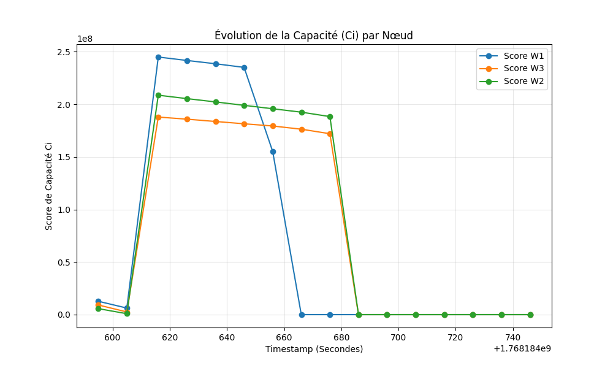
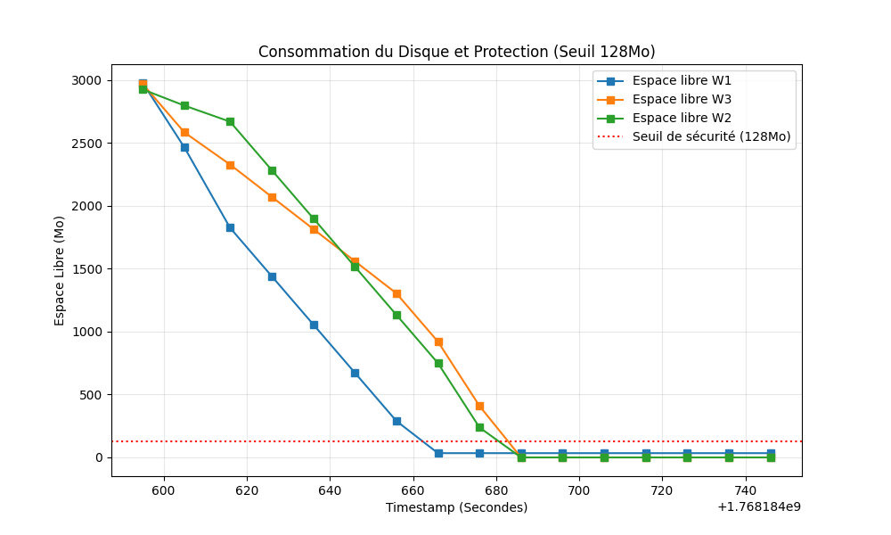
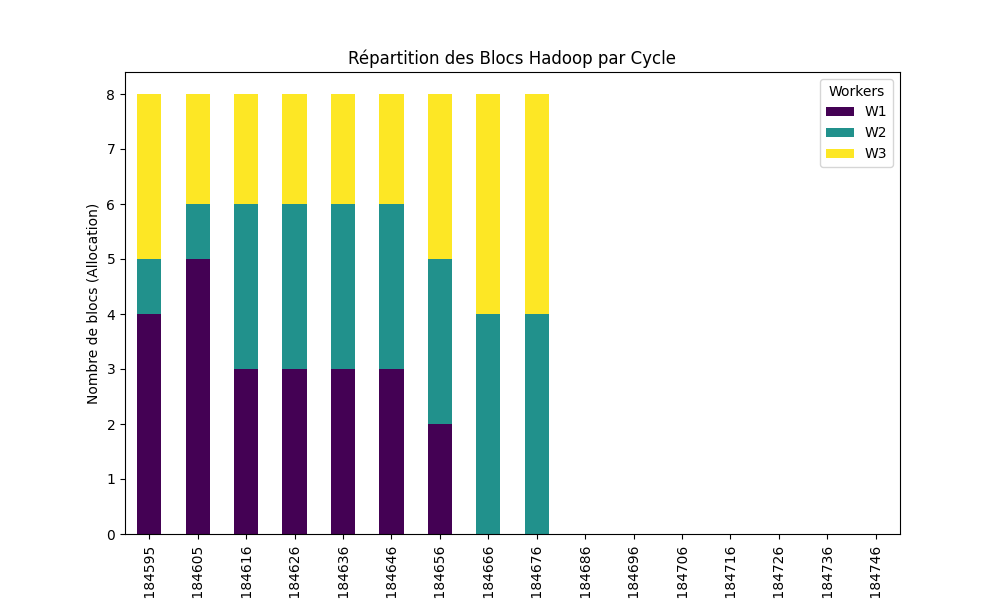
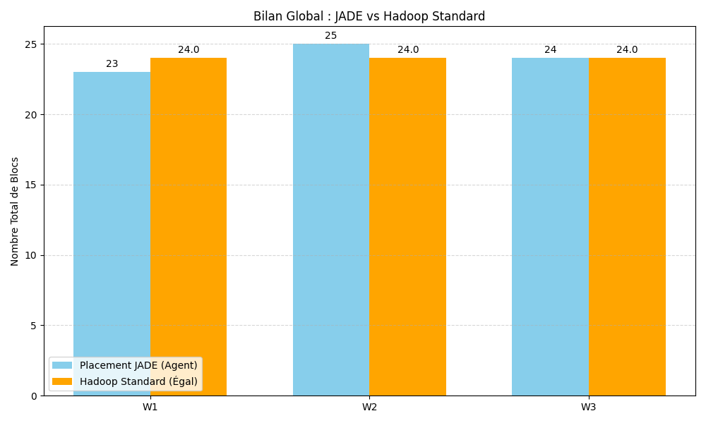

# 🤖 Multi-Agent System for Proactive Data Placement


An intelligent, distributed **Multi-Agent System (MAS)** developed using the **JADE (Java Agent Development Framework)** to simulate and optimize proactive data placement across heterogeneous storage systems.

---

## 📌 Project Overview

In large-scale heterogeneous storage environments, efficiently distributing data across nodes is a critical challenge. This project implements a **Master-Slave multi-agent architecture** where autonomous agents communicate, negotiate, and decide on the optimal placement of data blocks based on predictive metrics and multi-objective reinforcement learning concepts.

### 🔑 Key Features
* **JADE Agent Architecture**: Implementation of `MasterAgent` (coordinator) and `SlaveAgent` (storage nodes).
* **Distributed Communication**: Agents use FIPA-ACL (Agent Communication Language) messages to coordinate data distribution.
* **Proactive Placement Strategy**: Anticipates storage bottlenecks and intelligently routes data.
* **Python Visualization**: Dedicated Python scripts to parse cluster metrics and generate analytical plots.
* **Automated Cluster Management**: Bash scripts to easily spin up and tear down the JADE agent containers.

---

## 🏗️ Architecture

* **`MasterAgent.java`**: The central orchestrator that monitors the cluster, receives data placement requests, and negotiates with available slaves.
* **`SlaveAgent.java`**: Distributed nodes that report their storage capacities, read/write speeds, and health metrics back to the Master.
* **`Visualize.py` / `visualize2.py` / `visualize3.py`**: Python analytical tools that consume the output logs (`cluster_data.csv`) to visualize system performance.
* **`start-cluster.sh` & `stop-cluster.sh`**: Utility scripts to bootstrap the JADE main container and spawn the distributed agents.

---

## 📊 Analytics & Results

The system's performance is visualized through Python-generated plots evaluating the efficiency of the data placement strategy. The figures below illustrate the clustering metrics and load distribution:

| Metric 1 | Metric 2 |
| :---: | :---: |
|  |  |
|  |  |

---

## 🚀 Getting Started

### Prerequisites
* **Java Development Kit (JDK) 8+**
* **JADE Framework** (Ensure `jade.jar` is in your classpath)
* **Python 3.x** (for data visualization)
* `pandas` and `matplotlib` (`pip install pandas matplotlib`)

### 🛠️ Running the Cluster

1. **Start the Multi-Agent Cluster**:
   ```bash
   bash start-cluster.sh
   ```
   *This will launch the JADE Main Container, spawn the Master Agent, and initialize multiple Slave Agents.*

2. **Monitor & Visualize**:
   After the simulation generates `cluster_data.csv`, run the Python visualization scripts to see the results:
   ```bash
   python Visualize.py
   python visualize2.py
   ```

3. **Stop the Cluster**:
   ```bash
   bash stop-cluster.sh
   ```

---

## 📄 License

This project is licensed under the [MIT License](LICENSE) - see the LICENSE file for details.
